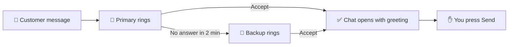

<p align="center"></p>

<h1 align="center">AOG Watcher</h1>

<p align="center">
  <b>The night-shift alarm for urgent AOG messages.</b><br>
  WhatsApp Web + Outlook → ring the right person → never miss a customer.
</p>

<p align="center">
  
  
  
  
</p>

<p align="center"><b>🇬🇧 English</b> · <a href="README.vi.md">🇻🇳 Tiếng Việt</a></p>

---

## 🌙 A night with AOG Watcher

> **23:47.** A customer group on WhatsApp writes: *"AOG at SGN, need the part tonight."*
>
> 🔔 Your laptop starts ringing.
> 👆 You click **Accept**. The ring stops, your partner's machine is told, and the customer chat opens with *"Well received. We are checking and will revert shortly."* already typed.
> ✋ You read it and press **Send** yourself.
>
> Asleep and missed it? After 2 minutes the **Backup** machine starts ringing instead.



> [!IMPORTANT]
> **AOG Watcher never sends a message for you.** It only types the greeting. If the wrong chat is open, it types nothing.

---

## 🧭 Who are you?

| | You are… | Read |
|---|---|---|
| 👤 | **Operator**: you work night shifts | [Set up once](#-operator-set-up-once-5-minutes) → [Your shift](#-your-shift) |
| 🧑‍✈️ | **Shift lead**: you plan the roster | [Fill the roster](#-shift-lead-fill-the-roster) → [Manage chats](#-shift-lead-manage-whatsapp-chats) |

---

## ⚠️ The two rules that matter

Everything links your machine to your row in the roster (`AOG_Shifts`) through **date + email**.

| | Rule | Why |
|---|---|---|
| 📧 | **Email** in the roster = the exact Microsoft 365 address you sign in with | Wrong email → the extension cannot find your row and **creates a second one**. Payroll then shows you twice. |
| 📅 | **ShiftDate** = the evening the night starts, typed `YYYY-MM-DD` | `2026-11-12` ✅ · `12/11/2026` ❌ (SharePoint refuses it) |

Your **name** is taken from the roster. If you type it differently in Settings, the extension corrects it and tells you: `Name updated to "Leah" from tonight's roster`.

> [!TIP]
> Not sure which email is yours? Open **Settings** → **Sign in & check**. The green box shows `Signed in: Your Name <you@company>`. Send that address to your shift lead once.

---

## 👤 Operator: set up once (5 minutes)

1. 📦 **Install.** Download this repository and unzip it into a folder you will keep. Open `chrome://extensions`, switch on **Developer mode**, click **Load unpacked**, pick the folder, and pin AOG Watcher.
2. 🔑 **Sign in.** Popup → **Settings** → **Sign in & check**.
   *Red error?* Click **Open SharePoint**, sign in with your company account, and try again.
3. 👀 **Check your name.** It should match the roster. If you are on tonight's roster, it is filled in for you.
4. 💾 **Save settings.**
5. 🌐 **Open both tabs:** WhatsApp Web (signed in) and Outlook Web at the AOG mailbox.

> [!NOTE]
> After every extension update, reload the WhatsApp and Outlook tabs.

---

## 🌃 Your shift

### 1️⃣ Pick your role

A night has two slots. On the **OFF SHIFT** screen, open **Tonight's shift times**:

| Slot | Default time | Choose |
|---|---|---|
| **Slot 1** | 22:00 → 02:30 | 🟣 Primary · 🟠 Backup · ⚪ Off |
| **Slot 2** | 02:30 → 07:00 | 🟣 Primary · 🟠 Backup · ⚪ Off |

- 🟣 **Primary** rings as soon as a message arrives.
- 🟠 **Backup** rings if Primary has not accepted in time.
- ⚪ **Off** never rings. Use it for the slot you do not work.

### 2️⃣ Start

Click **Start shift**. The **WATCHING** screen lists five checks. Fix each red one until you see **READY**:

| Check | Green when… |
|---|---|
| 💬 WhatsApp | the tab is open and was read recently |
| 📧 Outlook | the AOG mailbox tab is open |
| ☁️ SharePoint | you are signed in |
| 🤝 Partner machine | the other operator has started their shift |
| 🔊 Test ring heard | you clicked **Test ring** → **I hear it** |

### 3️⃣ When it rings

- 👆 **Accept**: stops the ring, tells your partner, opens the chat with the greeting.
- 👆👆 **Accept all (N)**: when several alerts wait.
- 👀 **Just open the chat** and read it while at your desk: that counts as Accept too.

### 4️⃣ End

Click **End shift** twice. Your check-out time and hours go to the roster.

---

## 📅 Shift lead: fill the roster

In the `AOG_Shifts` list, add **one row per person per night**. The extension fills every other column.

| OperatorName | ShiftDate | Email | Slot1Role | Slot2Role |
|---|---|---|---|---|
| Alex | 2026-11-12 | alex@trustana.vn | Primary | Off |
| Sam | 2026-11-12 | sam@trustana.vn | Off | Primary |

*Example: the night that starts on Wednesday evening, 12 November.*

> [!WARNING]
> **The early slot belongs to the evening before.** Someone working 02:30–07:00 on Thursday morning is entered with **Wednesday's** date.

- 📧 Copy emails from the operator's `Signed in:` line. No spaces, no personal Gmail.
- 🔢 **Slot 1 = 22:00–02:30.** Do not use the old "Ca 1" numbering.
- ℹ️ `Slot1Role` / `Slot2Role` are the plan for people to read. Each machine still takes its role from its own popup.

---

## 💬 Shift lead: manage WhatsApp chats

In the `AOG_Groups` list, one row per chat that should ring.

| Column | Enter |
|---|---|
| **Title** | The chat name **exactly** as WhatsApp shows it, emoji included. Copy it from the group info. |
| **Active** | **No** pauses a chat without deleting it. |
| **ChatType** | **Customer** or **Flyer**. Reserved: a later version will treat them differently. |
| **Note** | Anything for people. |

Machines reload the list when a shift starts and when Settings are saved. A chat that is not on the list still rings as **Unknown chat**, with **Add to shared list** and **Ignore** buttons.

---

## ⚙️ Settings at a glance

🔄 = **Shared**: saving it updates every machine. Everything else stays on your machine.

<details>
<summary><b>👤 Your account</b></summary>

| Setting | Meaning |
|---|---|
| SharePoint AOG link | `https://trustanavn.sharepoint.com/sites/aog`. Keep it. |
| Sign in & check | Connects and shows which email you are signed in with. |
| Display name | Your name. Filled from tonight's roster automatically. |

</details>

<details>
<summary><b>💬 WhatsApp</b></summary>

| Setting | Meaning |
|---|---|
| WhatsApp greeting | Typed into the customer chat after Accept. Blank = type nothing. |
| 🔄 Ring for unknown chats | A chat that is not on the list still rings. |
| My personal groups | Extra chats only this machine watches. |
| Ignored chats | Chats this machine never rings for. |

</details>

<details>
<summary><b>📧 Outlook 🔄</b></summary>

| Setting | Meaning |
|---|---|
| AOG mailbox path | The part of the Outlook address after `outlook.office.com`, e.g. `/mail/aog@company.com/`. |
| Only accept from senders | Optional. Only these emails or domains ring. |
| Ignored sender domains | Never ring for these. Default `trustana.vn`. |
| Subject keywords | Only these subjects ring. Blank = all. |

</details>

<details>
<summary><b>⏱️ Ringing & timing 🔄</b></summary>

| Setting | Default |
|---|---|
| Call Backup if not accepted after | 120 sec |
| Backup rings on its own after | 180 sec |
| Stop ringing after | 540 sec |
| Ring style (+ ▶ Preview) | Gentle, repeating |
| Follow up after Accept → Ask after → Ring again if no answer in | on · 10 min · 5 min |
| Machine unattended after | 15 sec |
| Partner machine lost after | 5 min |
| Start-shift reminder after | 10 min |
| Blind warning after (cannot read WhatsApp/Outlook) | 5 min |

</details>

<details>
<summary><b>🧪 Testing</b></summary>

| Setting | Meaning |
|---|---|
| Test mode + Test role | Ignore shift hours and act as Primary or Backup. |
| Dry-run | Do not ring and do not notify the partner machine. |

Turn both off before a real shift.

</details>

---

## 📋 SharePoint lists

All data lives on `https://trustanavn.sharepoint.com/sites/aog`. ✍️ = a person types it · 🤖 = the extension writes it.

<details>
<summary><b>💬 AOG_Groups</b>: chats to watch</summary>

| Column | | Meaning |
|---|---|---|
| Title | ✍️ | Chat name exactly as in WhatsApp |
| ChatType | ✍️ | Customer or Flyer (reserved) |
| Active | ✍️ | No = do not watch |
| AddedBy, AddedAt | 🤖 | Who added it from the popup, and when |
| Note | ✍️ | Free text |

</details>

<details>
<summary><b>⚙️ AOG_Settings</b>: shared settings</summary>

| Column | | Meaning |
|---|---|---|
| Key (Title) | 🤖 | Setting name, e.g. `log_keep_days` |
| Value | 🤖 | Setting value |
| UpdatedBy | 🤖 | Who changed it last |

Change these from **Settings**, not here. Only `log_keep_days` (default 90) is edited directly in the list.

</details>

<details>
<summary><b>🗓️ AOG_Shifts</b>: roster and payroll</summary>

| Column | | Meaning |
|---|---|---|
| OperatorName (Title) | ✍️ | Official name. Never overwritten by the extension. |
| ShiftDate | ✍️ | Evening date, `YYYY-MM-DD` |
| Email | ✍️ | Microsoft 365 address |
| Slot1Role, Slot2Role | ✍️ | Planned role per slot |
| Notes | ✍️ | Free text |
| CheckIn, CheckOut, Hours | 🤖 | When the shift started and ended, and hours worked |
| Ready | 🤖 | Whether the start-of-shift check passed |
| AlertCount, AcceptedCount, MissCount | 🤖 | Messages that rang, were accepted, were missed |
| AcceptLog | 🤖 | Time and chat of each Accept |

</details>

<details>
<summary><b>🧾 AOG_Log</b>: machine log, cleaned after 90 days</summary>

| Column | Meaning |
|---|---|
| RecordType | `Event` (something happened) · `Signal` (machine-to-machine message) · `Machine` (one row per machine) |
| Summary (Title) | Short label |
| EventType, At | What happened, when |
| ShiftId, AlertId | Which shift, which alert |
| Source, GroupOrSubject, Sender | WhatsApp or Outlook, chat or subject, sender |
| Role, OperatorName, Email, MachineId | Who, which machine |
| ResponseSeconds | Seconds from ring to Accept (Backup: from when it was called) |
| MissCause | Why an alert was missed |
| Ready, Version, Detail | Readiness, version, extra detail |

All 🤖.

</details>

---

## 🆘 Something is wrong

| You see | Do this |
|---|---|
| 🔴 WhatsApp or Outlook | Open or reload that tab. For Outlook, open the AOG mailbox. |
| 🔴 SharePoint | Open the AOG site and sign in again. Ringing keeps working meanwhile. |
| 🔴 Partner machine lost | Call the other operator: is their browser open and their shift started? |
| 🔴 You are not on tonight's roster | Ask the shift lead to add your row (right date and email). Ringing keeps working. |
| 📄 A second row of you in AOG_Shifts | Email or ShiftDate did not match. The shift lead fixes the planned row and deletes the extra one. |
| 💬 Wrong chat opened | Nothing was typed. Open the right chat, or reopen the alert from **Recent events**. |
| 🙈 A message never rang | Popup → **Help** → **Missed a message?** and log it. |
| ⚠️ Extension context invalidated | Reload the WhatsApp and Outlook tabs. |

More detail: [operating procedure](docs/SOP.md).

---

## 🧰 Development

Node.js + npm. JavaScript ES2022, Manifest V3, no build step.

```powershell
npm install
npm run check
```

`npm run check` validates the manifest and runs the Vitest suite. Architecture and working rules: [handoff/MAP.md](handoff/MAP.md), [handoff/RULES.md](handoff/RULES.md).

## 📄 License

[MIT](LICENSE)
