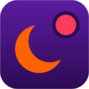

<p align="center">
  
</p>

<h1 align="center">AOG Watcher</h1>

<p align="center">
  Chuông báo thức thông minh cho ca trực đêm — canh WhatsApp và Outlook giùm bạn, để bạn được ngủ.
</p>

<p align="center">
  
  
  
  
</p>

---

## 🤔 Cái này là gì?

Bạn trực đêm. Khách có thể nhắn WhatsApp hoặc gửi email bất cứ lúc nào — 1h sáng, 3h sáng, ai biết được. Ngồi ôm màn hình cả đêm thì không nổi, mà ngủ thì sợ lỡ tin.

**AOG Watcher** là extension cho Chrome/Edge, làm đúng một việc: **canh tin nhắn giùm bạn**. Có tin mới từ khách → chuông reo đánh thức bạn dậy. Không có tin → bạn cứ ngủ ngon.

Điểm ăn tiền: nó được thiết kế cho **2 người trực cùng lúc** (một chính, một dự phòng). Người chính xử lý xong thì máy người dự phòng tự biết mà im lặng. Người chính ngủ quên? Máy người dự phòng tự reo sau vài phút. Không ai phải nhắn tay "ê tôi xử lý rồi nha".

## ⚙️ Hoạt động thế nào?

```
  WhatsApp Web ──┐
                 ├──> 👀 Phát hiện tin mới ──> 🔔 Chuông reo trên máy người trực CHÍNH
  Outlook Web ───┘                                      │
                                            (2 phút không ai xử lý?)
                                                        ▼
                                            🔔🔔 Máy người DỰ PHÒNG reo tiếp
```

1. Đầu ca, bạn mở sẵn tab WhatsApp Web + Outlook Web rồi bấm **Start Shift** — từ giây đó extension bắt đầu canh. Tin cũ trước ca không tính, không reo bậy.
2. Tin mới từ nhóm khách (hoặc mail vào hộp AOG) → chuông reo cho tới khi bạn bấm **ACK** ("tôi xử lý đây").
3. Bạn ACK → extension tự nhắn một dòng `[AOG-HANDLED]` vào nhóm điều phối trên WhatsApp → máy đồng đội thấy và im lặng.
4. Bạn ngủ say quá? Sau 2 phút máy đồng đội tự reo thay. Có lưới đỡ, không lọt tin.
5. Sáng ra, xuất báo cáo Excel: trực bao lâu, mấy alert, phản hồi mất bao nhiêu giây. Đủ số liệu chấm công.

Và vài thứ nhỏ mà đáng tiền:

- 😴 **Biết bạn đang thức.** Đang ngồi gõ phím chat với khách thì tin mới không reo ầm lên — chỉ hiện thông báo nhỏ. Rời máy 15 giây, chuông tự hoạt động lại.
- 🎵 **Chuông không hại tim.** Mặc định là nhạc dịu tần số thấp, to dần — đánh thức kiểu bình minh, không phải kiểu báo cháy. (Ai thích kiểu báo cháy vẫn chọn được trong Settings.)
- 🔍 **Không hoạt động ngầm khó hiểu.** Popup có panel Diagnostics cho biết extension đang "nhìn thấy" bao nhiêu tin, chặn bao nhiêu, vì sao — reo bậy hay im bậy đều truy ra được.

## 📦 Cài đặt (3 phút, không cần biết code)

**Bước 1 — Tải về:** bấm nút **Code** màu xanh ở đầu trang này → **Download ZIP** → giải nén ra một folder (nhớ chỗ để, đừng xóa folder sau khi cài).

**Bước 2 — Mở trang quản lý extension:**

- Chrome: gõ `chrome://extensions` vào thanh địa chỉ
- Edge: gõ `edge://extensions`

**Bước 3 — Nạp extension:** bật **Developer mode** → bấm **Load unpacked** → chọn folder vừa giải nén. Xong! Bấm hình ghim 📌 để icon AOG Watcher luôn hiện trên thanh công cụ.

## 🚀 Bắt đầu ca trực

1. **Cấu hình một lần** (chuột phải icon → Options): tên bạn, các nhóm WhatsApp khách cần canh, nhóm điều phối, đường dẫn hộp mail AOG.
2. Đầu ca: mở tab **WhatsApp Web** + tab **Outlook Web** (để yên ở hộp AOG) → bấm icon extension → **Start Shift**.
3. Thấy 2 chấm trạng thái WhatsApp/Outlook đều xanh → yên tâm đi ngủ. 😴
4. Hết ca: bấm **End Shift** → xuất báo cáo nếu cần.

> 💡 **Mẹo:** muốn đọc mail khác trong ca? Mở tab Outlook thứ hai. Tab được canh phải luôn đứng ở hộp AOG — extension chỉ thấy được những gì hiển thị trên màn hình.

📖 Quy trình trực chi tiết từng bước (setup 2 máy, bàn giao giữa ca, xuất báo cáo, xử lý sự cố): xem **[Cẩm nang vận hành — docs/SOP.md](docs/SOP.md)**.

## ❓ Câu hỏi thường gặp

**Chuông không reo dù có tin mới?**
Mở popup → panel **Diagnostics**, nó sẽ nói extension đang thấy gì và chặn gì. Ba thủ phạm quen mặt: chưa bấm Start Shift, tab Outlook đứng sai folder, tên nhóm khách trong Settings gõ không khớp.

**Vừa connect đã reo loạn xạ tin cũ?**
Từ bản 4.3 đã hết bệnh này — chỉ tin đến *sau* khi bấm Start Shift mới reo. Nếu vẫn bị, kiểm tra version ở `chrome://extensions`.

**Có gửi dữ liệu đi đâu không?**
Không. Zero server, zero tracking, zero dependency bên ngoài. Mọi thứ nằm trong máy bạn; tin nhắn duy nhất extension gửi là dòng tag điều phối vào nhóm WhatsApp do chính bạn cấu hình.

**Máy phải mở cả đêm à?**
Đúng — browser phải mở kèm 2 tab đó. Đây là cái giá của việc không cần server: extension đọc màn hình thay bạn, nên màn hình phải "sáng đèn".

## 🛠️ Dành cho dev

JavaScript ES2022 thuần, Manifest V3, không build tool, không dependency production. Test bằng Vitest:

```bash
npm install
npx vitest run                      # unit + integration tests
node tools/check_extension.mjs     # kiểm tra cấu trúc MV3
```

Current v4.3.0 suite: **133/133 tests** (111 existing + 22 field-feedback regressions).

Kiến trúc, quyết định thiết kế và lịch sử các round fix nằm trong `docs/` — bắt đầu từ `20260622_aog-watcher-v4-blueprint.md`.

## 📄 Giấy phép

[MIT](LICENSE) — dùng, sửa, chia sẻ thoải mái. Chỉ mong bạn trực đêm ngủ ngon hơn. 🌙
