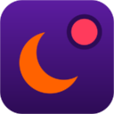
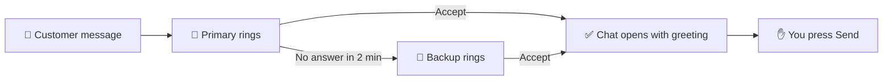

<p align="center"></p>

<h1 align="center">AOG Watcher</h1>

<p align="center">
  <b>The night-shift alarm for urgent AOG messages.</b><br>
  WhatsApp Web + Outlook → ring the right person → never miss a customer.
</p>

<p align="center">
  
  
  
  
</p>

<p align="center"><b>🇬🇧 English</b> · <a href="README.vi.md">🇻🇳 Tiếng Việt</a></p>

---

## 🌙 A night with AOG Watcher

> **23:47.** A customer group on WhatsApp writes: *"AOG at SGN, need the part tonight."*
>
> 🔔 Your laptop starts ringing.
> 👆 You click **Accept**. The ring stops, your partner's machine is told, and the customer chat opens with *"Well received. We are checking and will revert shortly."* already typed.
> ✋ You read it and press **Send** yourself.
>
> Asleep and missed it? After 2 minutes the **Backup** machine starts ringing instead.



> [!IMPORTANT]
> **AOG Watcher never sends a message for you.** It only types the greeting. If the wrong chat is open, it types nothing.

---

## 🧭 Who are you?

| | You are… | Read |
|---|---|---|
| 👤 | **Operator**: you work night shifts | [Set up once](#-operator-set-up-once-5-minutes) → [Your shift](#-your-shift) |
| 🧑‍✈️ | **Shift lead**: you plan the roster | [Fill the roster](#-shift-lead-fill-the-roster) → [Manage chats](#-shift-lead-manage-whatsapp-chats) |

---

## ⚠️ The two rules that matter

Your machine finds you in the roster (`AOG_Shifts`) by **email**, and knows when you watch from **Start / End**.

| | Rule | Why |
|---|---|---|
| 📧 | **Email** in the roster = the exact Microsoft 365 address you sign in with | Wrong email → your machine does not find you and **never rings**. |
| 🕙 | **Start / End** = date and 24-hour time, `YYYY-MM-DD HH:mm` | `2026-11-14 02:30` ✅ · `14/11 2h30` ❌ (the row is ignored) |

Your **name** is taken from the roster. If you type it differently in Settings, the extension corrects it: `Name updated to "Leah" from the roster`.

> [!TIP]
> Not sure which email is yours? Open **Settings** → **Sign in & check**. The green box shows `Signed in: Your Name <you@company>`. Send that address to your shift lead once.

---

## 👤 Operator: set up once (5 minutes)

1. 📦 **Install.** Download this repository and unzip it into a folder you will keep. Open `chrome://extensions`, switch on **Developer mode**, click **Load unpacked**, pick the folder, and pin AOG Watcher.
2. 🔑 **Sign in.** Popup → **Settings** → **Sign in & check**.
   *Red error?* Click **Open SharePoint**, sign in with your company account, and try again.
3. 👀 **Check your name.** It should match the roster. If you are on tonight's roster, it is filled in for you.
4. 💾 **Save settings.**
5. 🌐 **Open both tabs:** WhatsApp Web (signed in) and Outlook Web at the AOG mailbox.

> [!NOTE]
> After every extension update, reload the WhatsApp and Outlook tabs.

---

## 🌃 Your shift

**There is no Start shift or End shift.** Keep the browser open with WhatsApp Web and Outlook; the roster does the rest.

| When | Your machine |
|---|---|
| 🟣 Inside **your own** window | **Primary**: rings as soon as a message arrives |
| 🟠 Inside your **partner's** window of the same night | **Backup**: rings only if the partner has not accepted within 2 minutes |
| ⚪ Any other time | Off: never rings |

*Example: Julia 22:00 → 02:30, Ethan 02:30 → 07:00. From 22:00 Julia is Primary and Ethan Backup; at 02:30 they swap by themselves.*

### ✅ Check you are ready

Open the popup before your window starts. The **WATCHING** screen lists the checks; fix each red one until you see **READY**:

| Check | Green when… |
|---|---|
| 💬 WhatsApp | the tab is open and was read recently |
| 📧 Outlook | the Outlook tab is open |
| ☁️ SharePoint | you are signed in |
| 🤝 Partner machine | your partner's AOG Watcher is running |
| 🔊 Test ring heard | you clicked **Test ring** → **I hear it** |

If the person on watch has no running AOG Watcher, the Backup machine shows **"… AOG Watcher is offline"** (no ring): call them.

### 🔔 When it rings

- 👆 **Accept**: stops the ring on every machine. **Accept means done**: nothing asks again later. WhatsApp: opens the chat with the greeting typed. Outlook: brings Outlook forward.
- 👆👆 **Accept all (N)**: when several alerts wait.
- 👀 **Just open the chat** and read it while at your desk: that counts as Accept too.

### 🔕 Ring switches

While you are on watch, the Tonight tab shows three switches: **Sound**, **WhatsApp**, **Outlook**. Use them when your machine rings wrongly.

- **Sound off**: nothing rings on this machine. **WhatsApp off** / **Outlook off**: only that source stops ringing.
- Only your machine. The alert still waits for your Accept, and if you do not accept it goes to the Backup after the usual wait, as normal. A silenced alert you do not accept counts as a miss.
- All switches turn back on by themselves when your watch ends.

---

## 📅 Shift lead: fill the roster

In the `AOG_Shifts` list, add **one row per watch window**. The extension reads Start/End and only fills the four count columns on each person's own row (for payroll); it never creates rows.

| OperatorName | Email | Start | End |
|---|---|---|---|
| Julia | julia.trang@trustana.vn | 2026-11-13 22:00 | 2026-11-14 02:30 |
| Ethan | ethan.hieu@trustana.vn | 2026-11-14 02:30 | 2026-11-14 07:00 |
| Ryan | ryan.toan@trustana.vn | 2026-11-14 22:00 | 2026-11-15 07:00 |

- 🔗 **Windows that touch make one night.** Julia ends at 02:30 and Ethan starts at 02:30, so they back each other up. Ryan's window is another night: his machine stays silent on the 13th.
- 🕙 Write the **real date** of each time: 02:30 on the morning of the 14th is `2026-11-14 02:30`.
- 🔄 Swapping a shift = change the name and email on that row.
- 📧 Copy emails from the operator's `Signed in:` line. No spaces, no personal Gmail.
- 👥 **Everyone on the roster must be a member of every customer chat** in `AOG_Groups`. Accept opens the chat in the operator's own WhatsApp; if they are not in the chat, the ring stops but the chat cannot open.
- ℹ️ The older columns (ShiftDate, Slot1Role, Slot2Role, CheckIn, CheckOut, Hours, Ready) are no longer used and can be deleted.

---

## 💬 Shift lead: manage WhatsApp chats

In the `AOG_Groups` list, one row per chat that should ring.

| Column | Enter |
|---|---|
| **Title** | The chat name **exactly** as WhatsApp shows it, emoji included. Copy it from the group info. |
| **Active** | **No** pauses a chat without deleting it. |
| **ChatType** | **Customer** or **Flyer**. Reserved: a later version will treat them differently. |
| **Note** | Anything for people. |

Machines reload the list when a shift starts and when Settings are saved. A chat that is not on the list still rings as **Unknown chat**, with **Add to shared list** and **Ignore** buttons.

---

## ⚙️ Settings at a glance

🔄 = **Shared**: saving it updates every machine. Everything else stays on your machine.

<details>
<summary><b>👤 Your account</b></summary>

| Setting | Meaning |
|---|---|
| SharePoint AOG link | `https://trustanavn.sharepoint.com/sites/aog`. Keep it. |
| Sign in & check | Connects and shows which email you are signed in with. |
| Display name | Your name. Taken from the roster automatically. |

</details>

<details>
<summary><b>💬 WhatsApp</b></summary>

| Setting | Meaning |
|---|---|
| WhatsApp greeting | Typed into the customer chat after Accept. Blank = type nothing. |
| 🔄 Ring for unknown chats | A chat that is not on the list still rings. |
| My personal groups | Extra chats only this machine watches. |
| Ignored chats | Chats this machine never rings for. |

</details>

<details>
<summary><b>📧 Outlook</b></summary>

| Setting | Meaning |
|---|---|
| Outlook watch path | This machine only. Blank = watch whichever Outlook folder is open. Or a mailbox/folder path such as `/mail/aog@trustana.vn/`. Pasting the whole Outlook address works; the address of a single email is refused. |
| 🔄 Only accept from senders | Optional. Only these emails or domains ring. |
| 🔄 Ignored sender domains | Never ring for these. Default `trustana.vn`; it also skips internal senders Outlook shows by name only, such as "Leena \| TRUSTANA". |
| 🔄 Subject keywords | Only these subjects ring. Blank = all. |

</details>

<details>
<summary><b>⏱️ Ringing & timing 🔄</b></summary>

| Setting | Default |
|---|---|
| Call Backup if not accepted after | 120 sec |
| Backup rings on its own after | 180 sec |
| Stop ringing after | 540 sec |
| Ring style (+ ▶ Preview) | Gentle, repeating |
| Machine unattended after | 15 sec |
| Partner machine lost after | 5 min |
| Blind warning after (cannot read WhatsApp/Outlook) | 5 min |

</details>

---

## 🧪 Test tab: try it without waiting for a real AOG

The popup has a fourth tab, **Test 🔒**. It is locked so it stays out of the way during real shifts. Ask the shift lead for the password.

**1 · Mode**

| Role on this machine | What happens |
|---|---|
| 🟣 Primary | Rings first, as on a real night. |
| 🟠 Backup | Rings when the partner machine escalates. |
| 🔁 **Solo** | One machine plays both: it rings as Primary, and if nobody accepts within 2 minutes it switches to a **simulated Backup stage** with a louder ring. No second machine needed. |

**Test mode** starts watching right away, whatever the roster says; turning it off hands the watch back to the roster. **Dry-run** checks the flow silently: no ring, no signal to the partner. Click **Save test mode** after any change.

**2 · Simulate a message**

- 💬 **Simulate WhatsApp message**: rings like a real customer message. Type a real chat name (for example `AOG test`) and Accept will open that chat and type the greeting; leave it blank and Accept opens nothing.
- 📧 **Simulate Outlook email**: rings like a real AOG email, even if the email filters would skip it.

A simulated message follows the real path: if a partner machine is on shift as Backup, it receives the escalation too.

While **Test mode** is on, nothing is written to the event log in `AOG_Log`. Only the rows two machines need to see and escalate to each other (`Machine` and `Signal`) are still sent.

> [!TIP]
> To test a real WhatsApp message on one machine, send it **from your phone** to the test group. A message you type in WhatsApp Web on the same machine is outgoing, so it never rings.

> [!WARNING]
> Turn **Test mode** off and click **Save test mode** before a real shift.

---

## 📋 SharePoint lists

All data lives on `https://trustanavn.sharepoint.com/sites/aog`. ✍️ = a person types it · 🤖 = the extension writes it.

<details>
<summary><b>💬 AOG_Groups</b>: chats to watch</summary>

| Column | | Meaning |
|---|---|---|
| Title | ✍️ | Chat name exactly as in WhatsApp |
| ChatType | ✍️ | Customer or Flyer (reserved) |
| Active | ✍️ | No = do not watch |
| AddedBy, AddedAt | 🤖 | Who added it from the popup, and when |
| Note | ✍️ | Free text |

</details>

<details>
<summary><b>⚙️ AOG_Settings</b>: shared settings</summary>

| Column | | Meaning |
|---|---|---|
| Key (Title) | 🤖 | Setting name, e.g. `log_keep_days` |
| Value | 🤖 | Setting value |
| UpdatedBy | 🤖 | Who changed it last |

Change these from **Settings**, not here. Only `log_keep_days` (default 90) is edited directly in the list.

</details>

<details>
<summary><b>🗓️ AOG_Shifts</b>: roster and payroll counts</summary>

| Column | | Meaning |
|---|---|---|
| OperatorName (Title) | ✍️ | Name shown in the popup and the log |
| Email | ✍️ | Microsoft 365 address |
| Start | ✍️ | Start of the watch window, `YYYY-MM-DD HH:mm` |
| End | ✍️ | End of the watch window, `YYYY-MM-DD HH:mm` |
| AlertCount | 🤖 | Messages that rang on this person's machine during their night (counted once per message) |
| AcceptedCount | 🤖 | Of those, how many this person accepted |
| MissCount | 🤖 | Rang here but not accepted by this person (rang out, partner took it, still open at night end), plus missed-message reports. **As Backup, a message the person on watch took is never a miss.** |
| AcceptLog | 🤖 | Time and chat or subject of each Accept, e.g. `22:11 BlueLane AOG; 03:02 RE: AOG A321` |
| Notes | ✍️ | Free text |

Counts cover the person's **whole night** (their own window and the part where they are Backup), are updated during the night and at its end, and leave out Test tab messages. Example: Ethan lets a message ring out, Julia (Backup) accepts it → Ethan: Alert 1, Miss 1; Julia: Alert 1, Accepted 1. If Ethan accepts late while it rings on Julia → Ethan: Accepted 1; Julia: Alert 1, no miss.

Older columns (ShiftDate, Slot1Role, Slot2Role, CheckIn, CheckOut, Hours, Ready) are no longer used.

</details>

<details>
<summary><b>🧾 AOG_Log</b>: machine log, cleaned after 90 days</summary>

| Column | Meaning |
|---|---|
| RecordType | `Event` (something happened) · `Signal` (machine-to-machine message) · `Machine` (one row per machine) |
| Summary (Title) | Short label |
| EventType, At | What happened, when |
| ShiftId, AlertId | Which shift, which alert |
| Source, GroupOrSubject, Sender | WhatsApp or Outlook, chat or subject, sender |
| Role, OperatorName, Email, MachineId | Who, which machine |
| ResponseSeconds | Seconds from ring to Accept (Backup: from when it was called) |
| MissCause | Why an alert was missed |
| Ready, Version, Detail | Readiness, version, extra detail |

All 🤖. Only what is needed to reconstruct a night is written here, and only during a shift (plus **Shift ended** and missed-message reports). Test mode writes no `Event` rows.

</details>

---

## 🆘 Something is wrong

| You see | Do this |
|---|---|
| 🔴 WhatsApp or Outlook | Open or reload that tab. For Outlook, open the mailbox or folder set in **Outlook watch path** (or leave that blank). |
| 🔴 SharePoint | Open the AOG site and sign in again. Ringing keeps working meanwhile. |
| 🔴 "… AOG Watcher is offline" | The person on watch has no running AOG Watcher. Call them: is the browser open? Meanwhile watch WhatsApp and Outlook yourself. |
| 💬 Accepted, but the chat could not be opened | Your WhatsApp is not in that chat. Ask to be added; meanwhile answer from a phone that is. |
| ⚪ "Not on the roster" in the popup | Your email has no window in `AOG_Shifts`. Ask the shift lead to add it (right email, `YYYY-MM-DD HH:mm`). |
| 💬 Wrong chat opened | Nothing was typed. Open the right chat, or reopen the alert from **Recent events**. |
| 🙈 A message never rang | Popup → **Help** → **Missed a message?** and log it. |
| ⚠️ Extension context invalidated | Reload the WhatsApp and Outlook tabs. |

More detail: [operating procedure](docs/SOP.md).

---

## 🧰 Development

Node.js + npm. JavaScript ES2022, Manifest V3, no build step.

```powershell
npm install
npm run check
```

`npm run check` validates the manifest and runs the Vitest suite. Architecture and working rules: [handoff/MAP.md](handoff/MAP.md), [handoff/RULES.md](handoff/RULES.md).

## 📄 License

[MIT](LICENSE)
