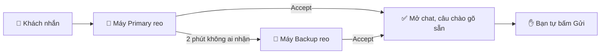

<h1 align="center">AOG Watcher</h1>

  <b>Chuông báo ca đêm cho tin AOG khẩn.</b> 
  WhatsApp Web + Outlook → reo đúng người → không bỏ sót khách.

  
  
  

<a href="README.md">🇬🇧 English</a> · <b>🇻🇳 Tiếng Việt</b>

> Tên nút trong extension là tiếng Anh. Hướng dẫn này giữ nguyên các tên đó trong **chữ đậm** để bạn tìm đúng chỗ bấm.

---

## 🌙 Một đêm với AOG Watcher

> **23:47.** Một nhóm khách trên WhatsApp nhắn: *"AOG tại SGN, cần phụ tùng ngay đêm nay."*
>
> 🔔 Laptop của bạn bắt đầu reo.
> 👆 Bạn bấm **Accept**. Chuông tắt, máy đồng đội được báo, chat của khách mở ra với câu *"Well received. We are checking and will revert shortly."* gõ sẵn trong ô nhập.
> ✋ Bạn đọc lại rồi tự bấm **Gửi**.
>
> Lỡ ngủ quên? Sau 2 phút, máy **Backup** sẽ reo thay.

> [!IMPORTANT]
> **AOG Watcher không bao giờ tự gửi tin.** Nó chỉ gõ sẵn câu chào. Mở nhầm chat thì nó không gõ gì.

---

## 🧭 Bạn là ai?

| | Bạn là… | Đọc phần |
|---|---|---|
| 👤 | **Người trực**: bạn trực ca đêm | [Cài một lần](#-người-trực-cài-một-lần-5-phút) → [Ca trực của bạn](#-ca-trực-của-bạn) |
| 🧑‍✈️ | **Trưởng ca**: bạn xếp lịch | [Điền lịch trực](#-trưởng-ca-điền-lịch-trực) → [Quản lý nhóm chat](#-trưởng-ca-quản-lý-nhóm-whatsapp) |

---

## ⚠️ Hai luật quan trọng nhất

Máy của bạn tìm dòng của bạn trong lịch trực (`AOG_Shifts`) bằng **ngày + email**.

| | Luật | Vì sao |
|---|---|---|
| 📧 | **Email** trong lịch = đúng y địa chỉ Microsoft 365 bạn dùng để đăng nhập | Sai email → máy không tìm thấy dòng của bạn và **tạo thêm một dòng mới**. Bảng lương sẽ có bạn hai lần. |
| 📅 | **ShiftDate** = ngày của buổi tối bắt đầu đêm trực, gõ dạng `YYYY-MM-DD` | `2026-11-12` ✅ · `12/11/2026` ❌ (SharePoint không cho lưu) |

**Tên** của bạn được lấy từ lịch trực. Bạn gõ khác trong Settings thì máy tự sửa lại và báo: `Name updated to "Leah" from tonight's roster`.

> [!TIP]
> Không chắc email nào là của mình? Mở **Settings** → bấm **Sign in & check**. Khung xanh hiện `Signed in: Tên bạn <email của bạn>`. Gửi địa chỉ đó cho trưởng ca một lần.

---

## 👤 Người trực: cài một lần (5 phút)

1. 📦 **Cài đặt.** Tải repo này về, giải nén vào một thư mục sẽ giữ lâu dài. Mở `chrome://extensions` (hoặc `edge://extensions`), bật **Developer mode**, bấm **Load unpacked**, chọn thư mục đó, rồi ghim AOG Watcher.
2. 🔑 **Đăng nhập.** Popup → **Settings** → **Sign in & check**.
   *Báo lỗi đỏ?* Bấm **Open SharePoint**, đăng nhập bằng tài khoản công ty, rồi thử lại.
3. 👀 **Kiểm tên.** Tên phải giống trong lịch trực. Có tên bạn trong lịch tối nay thì máy tự điền.
4. 💾 Bấm **Save settings**.
5. 🌐 **Mở hai tab:** WhatsApp Web (đã đăng nhập) và Outlook Web ở hộp thư AOG.

> [!NOTE]
> Mỗi lần cập nhật extension, tải lại tab WhatsApp và tab Outlook.

---

## 🌃 Ca trực của bạn

### 1️⃣ Chọn vai trò

Một đêm có hai slot. Ở màn **OFF SHIFT**, mở **Tonight's shift times**:

| Slot | Giờ mặc định | Chọn |
|---|---|---|
| **Slot 1** | 22:00 → 02:30 | 🟣 Primary · 🟠 Backup · ⚪ Off |
| **Slot 2** | 02:30 → 07:00 | 🟣 Primary · 🟠 Backup · ⚪ Off |

- 🟣 **Primary** reo ngay khi có tin.
- 🟠 **Backup** reo khi Primary không nhận kịp.
- ⚪ **Off** không bao giờ reo. Chọn Off cho slot bạn không trực.

### 2️⃣ Vào ca

Bấm **Start shift**. Màn **WATCHING** có năm dòng kiểm. Xử lý từng dòng đỏ cho đến khi thấy **READY**:

| Dòng kiểm | Xanh khi… |
|---|---|
| 💬 WhatsApp | tab đang mở và vừa được đọc |
| 📧 Outlook | tab hộp thư AOG đang mở |
| ☁️ SharePoint | bạn đã đăng nhập |
| 🤝 Partner machine | người trực máy kia đã bấm Start shift |
| 🔊 Test ring heard | bạn đã bấm **Test ring** → **I hear it** |

### 3️⃣ Khi máy reo

- 👆 **Accept**: tắt chuông, báo máy kia, mở chat kèm câu chào.
- 👆👆 **Accept all (N)**: khi có nhiều tin đang chờ.
- 👀 **Mở thẳng chat đó** và đọc khi bạn đang ngồi ở máy: cũng được tính là Accept.

### 4️⃣ Kết thúc ca

Bấm **End shift** hai lần. Giờ ra ca và số giờ trực được ghi vào lịch.

---

## 📅 Trưởng ca: điền lịch trực

Trong list `AOG_Shifts`, mỗi người mỗi đêm **một dòng**. Các cột còn lại máy tự điền.

| OperatorName | ShiftDate | Email | Slot1Role | Slot2Role |
|---|---|---|---|---|
| Alex | 2026-11-12 | alex@trustana.vn | Primary | Off |
| Sam | 2026-11-12 | sam@trustana.vn | Off | Primary |

*Ví dụ: đêm bắt đầu từ tối thứ Tư 12/11.*

> [!WARNING]
> **Ca rạng sáng thuộc về ngày hôm trước.** Người trực 02:30–07:00 sáng thứ Năm được nhập với ngày **thứ Tư**.

- 📧 Chép email từ dòng `Signed in:` của người trực. Không có dấu cách thừa, không dùng Gmail cá nhân.
- 🔢 **Slot 1 = 22:00–02:30.** Đừng dùng cách đánh số "Ca 1" của lịch cũ.
- ℹ️ `Slot1Role` / `Slot2Role` là kế hoạch để người đọc. Mỗi máy vẫn lấy vai trò từ popup của chính nó.

---

## 💬 Trưởng ca: quản lý nhóm WhatsApp

Trong list `AOG_Groups`, mỗi chat cần reo là một dòng.

| Cột | Điền |
|---|---|
| **Title** | Tên chat **đúng y** như WhatsApp hiển thị, kể cả emoji. Chép từ phần thông tin nhóm. |
| **Active** | **No** để tạm ngừng theo dõi mà không cần xoá. |
| **ChatType** | **Customer** hoặc **Flyer**. Dành cho bản sau, khi hai loại được xử lý khác nhau. |
| **Note** | Ghi chú tự do. |

Máy tải lại danh sách mỗi lần bắt đầu ca và mỗi lần lưu Settings. Chat chưa có trong danh sách vẫn reo dưới dạng **Unknown chat**, kèm nút **Add to shared list** (thêm vào danh sách chung) và **Ignore** (bỏ qua).

---

## ⚙️ Settings tóm tắt

🔄 = **Dùng chung**: bấm lưu là cập nhật cho mọi máy. Các mục còn lại chỉ áp dụng cho máy của bạn.

<b>👤 Your account (tài khoản)</b>

| Thiết lập | Ý nghĩa |
|---|---|
| SharePoint AOG link | `https://trustanavn.sharepoint.com/sites/aog`. Giữ nguyên. |
| Sign in & check | Kết nối và hiện email bạn đang đăng nhập. |
| Display name | Tên của bạn, tự lấy từ lịch trực tối nay. |

<b>💬 WhatsApp</b>

| Thiết lập | Ý nghĩa |
|---|---|
| WhatsApp greeting | Câu gõ sẵn vào chat của khách sau Accept. Để trống thì không gõ gì. |
| 🔄 Ring for unknown chats | Chat không có trong danh sách vẫn reo. |
| My personal groups | Chat thêm, chỉ máy này theo dõi. |
| Ignored chats | Chat máy này không bao giờ reo. |

<b>📧 Outlook</b>

| Thiết lập | Ý nghĩa |
|---|---|
| Outlook watch path | Chỉ máy này. Để trống = theo dõi thư mục Outlook đang mở. Hoặc điền đường dẫn hộp thư/thư mục, ví dụ `/mail/aog@trustana.vn/`. Dán cả địa chỉ Outlook cũng được; dán địa chỉ của một thư cụ thể thì bị từ chối. |
| 🔄 Only accept from senders | Không bắt buộc. Chỉ thư từ các email hoặc tên miền này mới reo. |
| 🔄 Ignored sender domains | Thư từ các tên miền này không reo. Mặc định `trustana.vn`. |
| 🔄 Subject keywords | Chỉ tiêu đề có các từ này mới reo. Để trống thì mọi thư đều reo. |

<b>⏱️ Ringing & timing (reo và thời gian) 🔄</b>

| Thiết lập | Mặc định |
|---|---|
| Call Backup if not accepted after (gọi Backup nếu chưa ai nhận sau) | 120 giây |
| Backup rings on its own after (Backup tự reo sau) | 180 giây |
| Stop ringing after (tự tắt chuông sau) | 540 giây |
| Ring style (+ ▶ Preview để nghe thử) | Gentle, repeating |
| Follow up after Accept → Ask after → Ring again if no answer in (hỏi lại vụ việc xong chưa) | bật · 10 phút · 5 phút |
| Machine unattended after (máy coi như không có người sau) | 15 giây |
| Partner machine lost after (mất liên lạc máy kia sau) | 5 phút |
| Start-shift reminder after (nhắc bấm Start shift sau) | 10 phút |
| Blind warning after (báo không đọc được WhatsApp/Outlook sau) | 5 phút |

<b>🧪 Testing (chạy thử)</b>

| Thiết lập | Ý nghĩa |
|---|---|
| Test mode + Test role | Bỏ qua giờ ca, đóng vai Primary hoặc Backup. |
| Dry-run | Không reo, không báo máy kia. |

Tắt cả hai trước ca thật.

---

## 📋 Các list trên SharePoint

Mọi dữ liệu nằm trên `https://trustanavn.sharepoint.com/sites/aog`. ✍️ = người gõ tay · 🤖 = máy tự ghi.

<b>💬 AOG_Groups</b>: các chat cần theo dõi

| Cột | | Ý nghĩa |
|---|---|---|
| Title | ✍️ | Tên chat đúng y như trên WhatsApp |
| ChatType | ✍️ | Customer hoặc Flyer (dành cho bản sau) |
| Active | ✍️ | No = không theo dõi |
| AddedBy, AddedAt | 🤖 | Ai thêm chat từ popup, lúc nào |
| Note | ✍️ | Ghi chú tự do |

<b>⚙️ AOG_Settings</b>: thiết lập dùng chung

| Cột | | Ý nghĩa |
|---|---|---|
| Key (Title) | 🤖 | Tên thiết lập, ví dụ `log_keep_days` |
| Value | 🤖 | Giá trị |
| UpdatedBy | 🤖 | Ai sửa lần cuối |

Đổi các thiết lập này trong **Settings**, không sửa thẳng ở đây. Chỉ `log_keep_days` (mặc định 90 ngày) được sửa trực tiếp trong list.

<b>🗓️ AOG_Shifts</b>: lịch trực và tính lương

| Cột | | Ý nghĩa |
|---|---|---|
| OperatorName (Title) | ✍️ | Tên chính thức. Máy không bao giờ ghi đè. |
| ShiftDate | ✍️ | Ngày buổi tối, `YYYY-MM-DD` |
| Email | ✍️ | Địa chỉ Microsoft 365 |
| Slot1Role, Slot2Role | ✍️ | Vai trò dự kiến từng slot |
| Notes | ✍️ | Ghi chú tự do |
| CheckIn, CheckOut, Hours | 🤖 | Giờ vào ca, giờ ra ca, số giờ trực |
| Ready | 🤖 | Bước kiểm đầu ca có đạt không |
| AlertCount, AcceptedCount, MissCount | 🤖 | Số tin đã reo, đã nhận, bị lỡ |
| AcceptLog | 🤖 | Giờ và tên chat của từng lần Accept |

<b>🧾 AOG_Log</b>: nhật ký của máy, tự dọn sau 90 ngày

| Cột | Ý nghĩa |
|---|---|
| RecordType | `Event` (một việc đã xảy ra) · `Signal` (tin giữa hai máy) · `Machine` (mỗi máy một dòng) |
| Summary (Title) | Nhãn ngắn |
| EventType, At | Việc gì, lúc nào |
| ShiftId, AlertId | Ca nào, tin nào |
| Source, GroupOrSubject, Sender | WhatsApp hay Outlook, tên chat hoặc tiêu đề thư, người gửi |
| Role, OperatorName, Email, MachineId | Ai, máy nào |
| ResponseSeconds | Số giây từ lúc reo đến lúc Accept (máy Backup: tính từ lúc được gọi) |
| MissCause | Lý do lỡ tin |
| Ready, Version, Detail | Trạng thái sẵn sàng, phiên bản, chi tiết |

Toàn bộ là 🤖.

---

## 🆘 Khi có sự cố

| Bạn thấy | Làm gì |
|---|---|
| 🔴 WhatsApp hoặc Outlook | Mở hoặc tải lại tab đó. Với Outlook, mở đúng hộp thư/thư mục đã điền ở **Outlook watch path** (hoặc để trống ô đó). |
| 🔴 SharePoint | Mở site AOG và đăng nhập lại. Trong lúc đó máy vẫn reo bình thường. |
| 🔴 Partner machine lost | Gọi người trực máy kia: trình duyệt có mở không, đã bấm Start shift chưa? |
| 🔴 You are not on tonight's roster | Nhờ trưởng ca thêm dòng của bạn (đúng ngày, đúng email). Máy vẫn reo bình thường. |
| 📄 AOG_Shifts có thêm một dòng tên bạn | Email hoặc ShiftDate không khớp. Trưởng ca sửa dòng đã xếp và xoá dòng thừa. |
| 💬 Mở nhầm chat | Ô nhập không bị gõ gì. Mở đúng chat, hoặc mở lại tin từ **Recent events**. |
| 🙈 Có tin mà máy không reo | Popup → **Help** → **Missed a message?** rồi ghi lại. |
| ⚠️ Extension context invalidated | Tải lại tab WhatsApp và tab Outlook. |

Chi tiết hơn (tiếng Anh): [quy trình vận hành](docs/SOP.md). Phần cho lập trình viên: [README tiếng Anh](README.md#-development).
