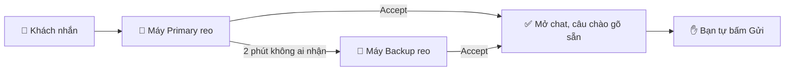

<h1 align="center">AOG Watcher</h1>

  <b>Chuông báo ca đêm cho tin AOG khẩn.</b> 
  WhatsApp Web + Outlook → reo đúng người → không bỏ sót khách.

  
  
  

<a href="README.md">🇬🇧 English</a> · <b>🇻🇳 Tiếng Việt</b>

> Tên nút trong extension là tiếng Anh. Hướng dẫn này giữ nguyên các tên đó trong **chữ đậm** để bạn tìm đúng chỗ bấm.

---

## 🌙 Một đêm với AOG Watcher

> **23:47.** Một nhóm khách trên WhatsApp nhắn: *"AOG tại SGN, cần phụ tùng ngay đêm nay."*
>
> 🔔 Laptop của bạn bắt đầu reo.
> 👆 Bạn bấm **Accept**. Chuông tắt, máy đồng đội được báo, chat của khách mở ra với câu *"Well received. We are checking and will revert shortly."* gõ sẵn trong ô nhập.
> ✋ Bạn đọc lại rồi tự bấm **Gửi**.
>
> Lỡ ngủ quên? Sau 2 phút, máy **Backup** sẽ reo thay.

> [!IMPORTANT]
> **AOG Watcher không bao giờ tự gửi tin.** Nó chỉ gõ sẵn câu chào. Mở nhầm chat thì nó không gõ gì.

---

## 🧭 Bạn là ai?

| | Bạn là… | Đọc phần |
|---|---|---|
| 👤 | **Người trực**: bạn trực ca đêm | [Cài một lần](#-người-trực-cài-một-lần-5-phút) → [Ca trực của bạn](#-ca-trực-của-bạn) |
| 🧑‍✈️ | **Trưởng ca**: bạn xếp lịch | [Điền lịch trực](#-trưởng-ca-điền-lịch-trực) → [Quản lý nhóm chat](#-trưởng-ca-quản-lý-nhóm-whatsapp) |

---

## ⚠️ Hai luật quan trọng nhất

Máy tìm bạn trong lịch trực (`AOG_Shifts`) bằng **email**, và biết khi nào bạn trực nhờ cột **Start / End**.

| | Luật | Vì sao |
|---|---|---|
| 📧 | **Email** trong lịch = đúng y địa chỉ Microsoft 365 bạn dùng để đăng nhập | Sai email → máy không tìm thấy bạn và **không bao giờ reo**. |
| 🕙 | **Start / End** = ngày và giờ 24h, dạng `YYYY-MM-DD HH:mm` | `2026-11-14 02:30` ✅ · `14/11 2h30` ❌ (dòng bị bỏ qua) |

**Tên** của bạn được lấy từ lịch trực. Bạn gõ khác trong Settings thì máy tự sửa lại và báo: `Name updated to "Leah" from the roster`.

> [!TIP]
> Không chắc email nào là của mình? Mở **Settings** → bấm **Sign in & check**. Khung xanh hiện `Signed in: Tên bạn <email của bạn>`. Gửi địa chỉ đó cho trưởng ca một lần.

---

## 👤 Người trực: cài một lần (5 phút)

1. 📦 **Cài đặt.** Tải repo này về, giải nén vào một thư mục sẽ giữ lâu dài. Mở `chrome://extensions` (hoặc `edge://extensions`), bật **Developer mode**, bấm **Load unpacked**, chọn thư mục đó, rồi ghim AOG Watcher.
2. 🔑 **Đăng nhập.** Popup → **Settings** → **Sign in & check**.
   *Báo lỗi đỏ?* Bấm **Open SharePoint**, đăng nhập bằng tài khoản công ty, rồi thử lại.
3. 👀 **Kiểm tên.** Tên phải giống trong lịch trực. Có tên bạn trong lịch tối nay thì máy tự điền.
4. 💾 Bấm **Save settings**.
5. 🌐 **Mở hai tab:** WhatsApp Web (đã đăng nhập) và Outlook Web ở hộp thư AOG.

> [!NOTE]
> Mỗi lần cập nhật extension, tải lại tab WhatsApp và tab Outlook.

---

## 🌃 Ca trực của bạn

**Không còn Start shift hay End shift.** Chỉ cần để trình duyệt mở với WhatsApp Web và Outlook; lịch trực lo phần còn lại.

| Khi nào | Máy của bạn |
|---|---|
| 🟣 Trong khung giờ **của bạn** | **Primary**: reo ngay khi có tin |
| 🟠 Trong khung giờ của **người cùng đêm** | **Backup**: chỉ reo khi người đó 2 phút chưa nhận |
| ⚪ Các lúc khác | Off: không bao giờ reo |

*Ví dụ: Julia 22:00 → 02:30, Ethan 02:30 → 07:00. Từ 22:00 Julia là Primary, Ethan là Backup; đến 02:30 hai người tự đổi vai.*

### ✅ Kiểm sẵn sàng

Mở popup trước giờ trực của bạn. Màn **WATCHING** có các dòng kiểm; xử lý từng dòng đỏ cho đến khi thấy **READY**:

| Dòng kiểm | Xanh khi… |
|---|---|
| 💬 WhatsApp | tab đang mở và vừa được đọc |
| 📧 Outlook | tab Outlook đang mở |
| ☁️ SharePoint | bạn đã đăng nhập |
| 🤝 Partner machine | AOG Watcher của người cùng đêm đang chạy |
| 🔊 Test ring heard | bạn đã bấm **Test ring** → **I hear it** |

Nếu người đang trực không có AOG Watcher nào đang chạy, máy Backup hiện dòng **"… AOG Watcher is offline"** (không reo): gọi cho người đó.

### 🔔 Khi máy reo

- 👆 **Accept**: tắt chuông trên mọi máy. **Accept là xong việc**: máy không hỏi lại nữa. WhatsApp: mở chat, gõ sẵn câu chào. Outlook: đưa Outlook lên trước.
- 👆👆 **Accept all (N)**: khi có nhiều tin đang chờ.
- 👀 **Mở thẳng chat đó** và đọc khi bạn đang ngồi ở máy: cũng được tính là Accept.

### 🔕 Công tắc reo

Khi bạn đang trực, tab Tonight có ba công tắc: **Sound**, **WhatsApp**, **Outlook**. Dùng khi máy reo sai.

- **Tắt Sound**: máy này không reo gì cả. **Tắt WhatsApp** / **tắt Outlook**: chỉ nguồn đó thôi reo.
- Chỉ có tác dụng trên máy bạn. Tin vẫn chờ bạn bấm Accept; bạn không bấm thì sau thời gian chờ như thường lệ, tin vẫn chuyển sang người dự phòng. Tin đã tắt tiếng mà bạn không bấm Accept thì tính là Miss.
- Hết ca trực, cả ba công tắc tự bật lại.

---

## 📅 Trưởng ca: điền lịch trực

Trong list `AOG_Shifts`, mỗi **khung giờ trực** là một dòng. Máy đọc cột Start/End, và chỉ ghi bốn cột đếm trên dòng của chính người trực (để tính tiền trực); máy không bao giờ tạo dòng mới.

| OperatorName | Email | Start | End |
|---|---|---|---|
| Julia | julia.trang@trustana.vn | 2026-11-13 22:00 | 2026-11-14 02:30 |
| Ethan | ethan.hieu@trustana.vn | 2026-11-14 02:30 | 2026-11-14 07:00 |
| Ryan | ryan.toan@trustana.vn | 2026-11-14 22:00 | 2026-11-15 07:00 |

- 🔗 **Các khung giờ nối liền nhau là cùng một đêm.** Julia kết thúc 02:30, Ethan bắt đầu 02:30, nên hai người dự phòng cho nhau. Khung của Ryan là đêm khác: máy Ryan im lặng đêm 13.
- 🕙 Ghi **đúng ngày thật** của từng mốc: 02:30 sáng ngày 14 là `2026-11-14 02:30`.
- 🔄 Đổi ca = sửa tên và email trên dòng đó.
- 📧 Chép email từ dòng `Signed in:` của người trực. Không có dấu cách thừa, không dùng Gmail cá nhân.
- 👥 **Mọi người trong lịch phải có mặt trong mọi nhóm khách** ở `AOG_Groups`. Accept mở chat trong WhatsApp của chính người trực; không có trong nhóm thì chuông vẫn tắt nhưng không mở được chat.
- ℹ️ Các cột cũ (ShiftDate, Slot1Role, Slot2Role, CheckIn, CheckOut, Hours, Ready) không còn dùng, xoá được.

---

## 💬 Trưởng ca: quản lý nhóm WhatsApp

Trong list `AOG_Groups`, mỗi chat cần reo là một dòng.

| Cột | Điền |
|---|---|
| **Title** | Tên chat **đúng y** như WhatsApp hiển thị, kể cả emoji. Chép từ phần thông tin nhóm. |
| **Active** | **No** để tạm ngừng theo dõi mà không cần xoá. |
| **ChatType** | **Customer** hoặc **Flyer**. Dành cho bản sau, khi hai loại được xử lý khác nhau. |
| **Note** | Ghi chú tự do. |

Máy tải lại danh sách mỗi lần bắt đầu ca và mỗi lần lưu Settings. Chat chưa có trong danh sách vẫn reo dưới dạng **Unknown chat**, kèm nút **Add to shared list** (thêm vào danh sách chung) và **Ignore** (bỏ qua).

---

## ⚙️ Settings tóm tắt

🔄 = **Dùng chung**: bấm lưu là cập nhật cho mọi máy. Các mục còn lại chỉ áp dụng cho máy của bạn.

<b>👤 Your account (tài khoản)</b>

| Thiết lập | Ý nghĩa |
|---|---|
| SharePoint AOG link | `https://trustanavn.sharepoint.com/sites/aog`. Giữ nguyên. |
| Sign in & check | Kết nối và hiện email bạn đang đăng nhập. |
| Display name | Tên của bạn, tự lấy từ lịch trực. |

<b>💬 WhatsApp</b>

| Thiết lập | Ý nghĩa |
|---|---|
| WhatsApp greeting | Câu gõ sẵn vào chat của khách sau Accept. Để trống thì không gõ gì. |
| 🔄 Ring for unknown chats | Chat không có trong danh sách vẫn reo. |
| My personal groups | Chat thêm, chỉ máy này theo dõi. |
| Ignored chats | Chat máy này không bao giờ reo. |

<b>📧 Outlook</b>

| Thiết lập | Ý nghĩa |
|---|---|
| Outlook watch path | Chỉ máy này. Để trống = theo dõi thư mục Outlook đang mở. Hoặc điền đường dẫn hộp thư/thư mục, ví dụ `/mail/aog@trustana.vn/`. Dán cả địa chỉ Outlook cũng được; dán địa chỉ của một thư cụ thể thì bị từ chối. |
| 🔄 Only accept from senders | Không bắt buộc. Chỉ thư từ các email hoặc tên miền này mới reo. |
| 🔄 Ignored sender domains | Thư từ các tên miền này không reo. Mặc định `trustana.vn`; cũng bỏ qua thư nội bộ mà Outlook chỉ hiện tên, ví dụ "Leena \| TRUSTANA". |
| 🔄 Subject keywords | Chỉ tiêu đề có các từ này mới reo. Để trống thì mọi thư đều reo. |

<b>⏱️ Ringing & timing (reo và thời gian) 🔄</b>

| Thiết lập | Mặc định |
|---|---|
| Call Backup if not accepted after (gọi Backup nếu chưa ai nhận sau) | 120 giây |
| Backup rings on its own after (Backup tự reo sau) | 180 giây |
| Stop ringing after (tự tắt chuông sau) | 540 giây |
| Ring style (+ ▶ Preview để nghe thử) | Gentle, repeating |
| Machine unattended after (máy coi như không có người sau) | 15 giây |
| Partner machine lost after (mất liên lạc máy kia sau) | 5 phút |
| Blind warning after (báo không đọc được WhatsApp/Outlook sau) | 5 phút |

---

## 🧪 Tab Test: thử mà không cần chờ tin AOG thật

Popup có tab thứ tư là **Test 🔒**. Tab này bị khoá để không làm rối mắt trong ca thật; hỏi trưởng ca mật khẩu.

**1 · Mode (chế độ)**

| Vai trò trên máy này | Điều gì xảy ra |
|---|---|
| 🟣 Primary | Reo trước, như một đêm thật. |
| 🟠 Backup | Reo khi máy kia chuyển tin sang. |
| 🔁 **Solo** | Một máy đóng cả hai vai: reo như Primary; nếu sau 2 phút chưa ai nhận thì chuyển sang **giai đoạn Backup giả lập**, chuông to hơn. Không cần máy thứ hai. |

Bật **Test mode** là máy trực ngay, bất kể lịch; tắt đi thì máy quay về theo lịch trực. **Dry-run** chạy thử im lặng: không reo, không báo máy kia. Đổi gì thì bấm **Save test mode**.

**2 · Simulate a message (giả lập tin)**

- 💬 **Simulate WhatsApp message**: reo như tin khách thật. Gõ tên một chat có thật (ví dụ `AOG test`) thì khi Accept máy sẽ mở chat đó và gõ sẵn câu chào; để trống thì Accept không mở gì.
- 📧 **Simulate Outlook email**: reo như thư AOG thật, kể cả khi bộ lọc thư lẽ ra sẽ bỏ qua.

Tin giả lập đi đúng đường của tin thật: nếu có máy khác đang trực vai Backup, máy đó cũng nhận được tín hiệu chuyển tin.

Khi bật **Test mode**, máy không ghi nhật ký sự kiện vào `AOG_Log`. Máy chỉ vẫn gửi hai loại dòng cần để hai máy thấy nhau và chuyển tin cho nhau (`Machine` và `Signal`).

> [!TIP]
> Muốn thử tin WhatsApp thật trên một máy, hãy nhắn **từ điện thoại** vào nhóm test. Tin bạn gõ trên WhatsApp Web của chính máy đó là tin gửi đi, nên không bao giờ reo.

> [!WARNING]
> Trước ca thật, tắt **Test mode** và bấm **Save test mode**.

---

## 📋 Các list trên SharePoint

Mọi dữ liệu nằm trên `https://trustanavn.sharepoint.com/sites/aog`. ✍️ = người gõ tay · 🤖 = máy tự ghi.

<b>💬 AOG_Groups</b>: các chat cần theo dõi

| Cột | | Ý nghĩa |
|---|---|---|
| Title | ✍️ | Tên chat đúng y như trên WhatsApp |
| ChatType | ✍️ | Customer hoặc Flyer (dành cho bản sau) |
| Active | ✍️ | No = không theo dõi |
| AddedBy, AddedAt | 🤖 | Ai thêm chat từ popup, lúc nào |
| Note | ✍️ | Ghi chú tự do |

<b>⚙️ AOG_Settings</b>: thiết lập dùng chung

| Cột | | Ý nghĩa |
|---|---|---|
| Key (Title) | 🤖 | Tên thiết lập, ví dụ `log_keep_days` |
| Value | 🤖 | Giá trị |
| UpdatedBy | 🤖 | Ai sửa lần cuối |

Đổi các thiết lập này trong **Settings**, không sửa thẳng ở đây. Chỉ `log_keep_days` (mặc định 90 ngày) được sửa trực tiếp trong list.

<b>🗓️ AOG_Shifts</b>: lịch trực và số đếm tính tiền trực

| Cột | | Ý nghĩa |
|---|---|---|
| OperatorName (Title) | ✍️ | Tên hiện trên popup và trong nhật ký |
| Email | ✍️ | Địa chỉ Microsoft 365 |
| Start | ✍️ | Giờ bắt đầu khung trực, `YYYY-MM-DD HH:mm` |
| End | ✍️ | Giờ kết thúc khung trực, `YYYY-MM-DD HH:mm` |
| AlertCount | 🤖 | Số tin đã reo trên máy người này trong đêm của họ (mỗi tin tính một lần) |
| AcceptedCount | 🤖 | Trong số đó, bao nhiêu tin người này bấm Accept |
| MissCount | 🤖 | Tin reo trên máy này nhưng người này không bấm Accept (reo hết giờ, người kia nhận, còn treo lúc hết đêm), cộng các báo cáo lọt tin. **Khi đang là dự phòng, tin mà người trực chính nhận thì không bao giờ tính Miss.** |
| AcceptLog | 🤖 | Giờ và tên chat hoặc tiêu đề mỗi lần Accept, ví dụ `22:11 BlueLane AOG; 03:02 RE: AOG A321` |
| Notes | ✍️ | Ghi chú tự do |

Số đếm tính cho **cả đêm** của người đó (khung của mình và phần làm dự phòng), cập nhật trong đêm và lúc hết đêm, không tính tin thử ở tab Test. Ví dụ: Ethan để tin reo hết giờ, Julia (dự phòng) bấm Accept → Ethan: Alert 1, Miss 1; Julia: Alert 1, Accepted 1. Nếu Ethan bấm Accept muộn lúc tin đang reo trên máy Julia → Ethan: Accepted 1; Julia: Alert 1, không Miss.

Các cột cũ (ShiftDate, Slot1Role, Slot2Role, CheckIn, CheckOut, Hours, Ready) không còn dùng.

<b>🧾 AOG_Log</b>: nhật ký của máy, tự dọn sau 90 ngày

| Cột | Ý nghĩa |
|---|---|
| RecordType | `Event` (một việc đã xảy ra) · `Signal` (tin giữa hai máy) · `Machine` (mỗi máy một dòng) |
| Summary (Title) | Nhãn ngắn |
| EventType, At | Việc gì, lúc nào |
| ShiftId, AlertId | Ca nào, tin nào |
| Source, GroupOrSubject, Sender | WhatsApp hay Outlook, tên chat hoặc tiêu đề thư, người gửi |
| Role, OperatorName, Email, MachineId | Ai, máy nào |
| ResponseSeconds | Số giây từ lúc reo đến lúc Accept (máy Backup: tính từ lúc được gọi) |
| MissCause | Lý do lỡ tin |
| Ready, Version, Detail | Trạng thái sẵn sàng, phiên bản, chi tiết |

Toàn bộ là 🤖. Chỉ ghi những gì cần để dựng lại một đêm trực, và chỉ ghi trong ca (cộng thêm dòng **Shift ended** và báo cáo tin bị lỡ). Test mode không ghi dòng `Event`.

---

## 🆘 Khi có sự cố

| Bạn thấy | Làm gì |
|---|---|
| 🔴 WhatsApp hoặc Outlook | Mở hoặc tải lại tab đó. Với Outlook, mở đúng hộp thư/thư mục đã điền ở **Outlook watch path** (hoặc để trống ô đó). |
| 🔴 SharePoint | Mở site AOG và đăng nhập lại. Trong lúc đó máy vẫn reo bình thường. |
| 🔴 "… AOG Watcher is offline" | Người đang trực không có AOG Watcher nào chạy. Gọi cho họ: trình duyệt có mở không? Trong lúc đó tự để mắt WhatsApp và Outlook. |
| 💬 Accepted, but the chat could not be opened | WhatsApp của bạn không có trong nhóm đó. Nhờ thêm vào nhóm; trong lúc chờ, trả lời bằng điện thoại có trong nhóm. |
| ⚪ "Not on the roster" trên popup | Email của bạn không có khung giờ nào trong `AOG_Shifts`. Nhờ trưởng ca thêm (đúng email, dạng `YYYY-MM-DD HH:mm`). |
| 💬 Mở nhầm chat | Ô nhập không bị gõ gì. Mở đúng chat, hoặc mở lại tin từ **Recent events**. |
| 🙈 Có tin mà máy không reo | Popup → **Help** → **Missed a message?** rồi ghi lại. |
| ⚠️ Extension context invalidated | Tải lại tab WhatsApp và tab Outlook. |

Chi tiết hơn (tiếng Anh): [quy trình vận hành](docs/SOP.md). Phần cho lập trình viên: [README tiếng Anh](README.md#-development).
